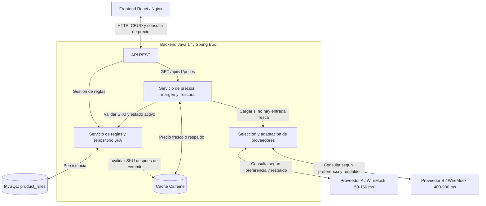

# Sistema de gestión y consulta consolidada de precios

Aplicación Fullstack que administra reglas comerciales en MySQL e integra dos
proveedores REST para calcular precios finales. Incluye una SPA React, un
middleware Java, caché en memoria y proveedores simulados en WireMock.

## Diagrama End-to-End



El frontend envía solicitudes al middleware. El CRUD persiste las reglas en MySQL.
La consulta de precios valida la regla, reutiliza la caché cuando corresponde o
consulta los proveedores, y devuelve el precio consolidado. Las escrituras del
CRUD invalidan la caché del SKU después de confirmar la transacción.

## Ejecución

Requisito: Docker Engine con Docker Compose v2, o Docker Desktop. Docker compila
Java y React; no hace falta instalar Java, Maven, Node.js ni MySQL para arrancar.
Desde la raíz del repositorio:

```bash
docker compose up --build
```

Para ejecutar en segundo plano y esperar las comprobaciones de disponibilidad:

```bash
docker compose up --build --detach --wait
```

| Servicio | Dirección local predeterminada |
|---|---|
| Frontend | http://localhost:3000 |
| API del middleware | http://localhost:8080/api/v1 |
| Salud del backend | http://localhost:8080/actuator/health |
| Proveedor A | http://localhost:8081/api/prices?sku=GAS-CORRIENTE |
| Proveedor B | http://localhost:8082/api/prices?sku=GAS-CORRIENTE |
| MySQL | `127.0.0.1:3306`, base `pricing` |

MySQL debe estar disponible antes de arrancar el backend. El frontend espera al
backend y los proveedores tienen sus propias comprobaciones de disponibilidad.
La comprobación de MySQL ejecuta `SELECT 1` autenticado; la del backend incluye
su conexión a la base de datos.

```bash
docker compose ps
docker compose logs backend
docker compose down
```

`down` conserva el volumen de MySQL. Los scripts de `database/init/` crean el
esquema y los datos de demostración **solo cuando el volumen está vacío**. Reiniciar
no reinserta productos borrados ni sobrescribe cambios. Hibernate valida el
esquema; la creación inicial se realiza con los scripts SQL de MySQL.

### Configuración

El arranque funciona con valores predeterminados. Opcionalmente copiar
`.env.example` a `.env` y ajustar los valores antes de arrancar. `.env` se excluye
de Git. Las credenciales predeterminadas son exclusivamente de desarrollo local.

| Variable | Predeterminado | Uso |
|---|---|---|
| `MYSQL_PORT` | `3306` | Puerto local de MySQL. |
| `MYSQL_DATABASE` | `pricing` | Nombre de la base. |
| `MYSQL_USER` | `pricing_app` | Usuario de aplicación. |
| `MYSQL_PASSWORD` | `pricing_local_password` | Contraseña del usuario. |
| `MYSQL_ROOT_PASSWORD` | `pricing_root_local_password` | Contraseña de administración. |
| `BACKEND_PORT` | `8080` | Puerto local de la API. |
| `FRONTEND_PORT` | `3000` | Puerto local de la SPA. |
| `PROVIDER_A_PORT` / `PROVIDER_B_PORT` | `8081` / `8082` | Puertos locales de WireMock. |
| `PROVIDER_A_CONNECT_TIMEOUT_MS` / `PROVIDER_A_READ_TIMEOUT_MS` | `200` / `250` | Timeouts HTTP de A. |
| `PROVIDER_B_CONNECT_TIMEOUT_MS` / `PROVIDER_B_READ_TIMEOUT_MS` | `200` / `1000` | Timeouts HTTP de B. |
| `PRICE_CACHE_FRESH_TTL` | `60s` | Reutilización de un precio fresco. |
| `PRICE_CACHE_FALLBACK_TTL` | `15m` | Retención total del respaldo desde su carga. |
| `PRICE_CACHE_MAXIMUM_SIZE` | `10000` | Máximo de entradas en memoria. |

Los puertos publicados se enlazan a `127.0.0.1`. Dentro de Docker, el backend usa
los nombres de servicio `mysql`, `provider-a` y `provider-b`; cambiar los puertos
locales no cambia estas conexiones internas.

## Arquitectura y decisiones

| Componente | Tecnología y función |
|---|---|
| Middleware | Java 17, Spring Boot 3.5.16, Spring MVC y RestClient. |
| Persistencia | MySQL 8.4, InnoDB, Spring Data JPA y transacciones. |
| Caché | Caffeine en la memoria de una instancia del backend. |
| Frontend | React 19, JavaScript y CSS; Vite para desarrollo y compilación. |
| Servidor web | Nginx sirve la SPA y reenvía `/api` al backend. |
| Proveedores | Dos servicios HTTP separados con WireMock 3.13.2. |
| Pruebas | JUnit 5, Mockito y Testcontainers. |

El backend se organiza por funcionalidad (`productrule`, `price`, `provider` y
`common`) y por capas: controladores para el contrato HTTP, servicios para reglas
de negocio, repositorios para persistencia y clientes para integración externa.
Los DTO de cada proveedor se adaptan a un modelo común `ProviderPrice`; el resto
del negocio no depende de sus diferentes nombres de campos o formatos de fecha.

La SPA usa componentes para tabla, formulario y consulta de precios, coordinados
en `App.jsx`. `api.js` centraliza HTTP y errores. Las solicitudes tienen una espera
máxima de 10 segundos y se muestran estados de carga. Al guardar o eliminar se
limpia el precio visible; respuestas antiguas de consultas o listados no reemplazan
una respuesta más reciente. Nginx mantiene frontend y API bajo el mismo origen,
sin requerir CORS para este despliegue.

### Consulta y consolidación

1. Normalizar el SKU y consultar MySQL. Un SKU inexistente responde `404`; uno
   inactivo responde `422`, incluso si existía un precio en caché.
2. Reutilizar una entrada de caché solo si aún cumple el TTL fresco y la fecha
   original del proveedor sigue vigente.
3. Si hace falta cargar, elegir el orden por `preferredProvider`:

   | Preferencia | Primero | Respaldo si falla o entrega un dato obsoleto |
   |---|---|---|
   | `AUTO` | A | B |
   | `PROVIDER_A` | A | B |
   | `PROVIDER_B` | B | A |

4. Devolver el primer precio fresco. Si ninguno está fresco, devolver el precio
   obsoleto disponible con `stale=true`; si ambos están obsoletos, priorizar B por
   su carácter autoritativo. No se promedian precios.
5. Si ninguno entrega un precio utilizable, intentar el respaldo en caché. Sin
   respaldo vigente, responder `503` con un error controlado.
6. Calcular `finalPrice = providerPrice × (1 + marginPercentage / 100)` usando
   `BigDecimal`, con un único redondeo final a dos decimales (`HALF_UP`).

Un precio es obsoleto cuando su fecha original tiene **más de 15 minutos**;
exactamente 15 minutos aún es válido. Fechas más de 30 segundos en el futuro se
rechazan como respuesta inválida. A entrega `lastUpdated` en ISO 8601 y B un
`timestamp` Unix en segundos; ambos se convierten a `Instant` UTC.

Se consulta secuencialmente para evitar llamadas innecesarias a B cuando A ya
ofrece un precio fresco. La caché y la carga coordinada por clave reducen llamadas
en ráfagas del mismo producto. **Todavía no se acredita el objetivo de p95 menor
a 800 ms:** B puede tardar 900 ms y el respaldo secuencial añade espera.

### Caché e invalidación

Se elige Caffeine por la simplicidad del MVP con una instancia: no requiere otro
servicio y el acceso es local. Se conserva el precio normalizado del proveedor y
el instante monotónico de carga; el margen se aplica al construir la respuesta.

La clave es un `PriceCacheKey` con una instantánea de la regla:

```text
(id, sku, name, marginPercentage, preferredProvider, active, updatedAt)
```

Esto distingue versiones editadas y reglas borradas y recreadas con el mismo SKU.
Una carga que estaba en curso para una versión anterior no se reutiliza bajo la
clave de la versión nueva.

- **Fresco:** hasta 60 segundos desde la carga, siempre que la fecha del proveedor
  siga fresca. Una lectura no renueva ese plazo. La respuesta indica `CACHE`.
- **Respaldo:** se conserva hasta 15 minutos totales desde la carga, sujeto a la
  capacidad de la caché. Tras vencer el plazo fresco, se intenta consultar a los
  proveedores; si fallan, se devuelve `FALLBACK_CACHE` con `stale=true`.
- **Invalidación:** crear, editar o borrar publica `ProductRuleChanged`. El
  listener elimina las entradas del SKU únicamente después de confirmar la
  transacción (`AFTER_COMMIT`). Un rollback no invalida una entrada válida.
  Desactivar usa el mismo flujo de actualización.
- **Concurrencia:** `compute` de Caffeine coordina la carga por clave. Si una carga
  obtiene un precio fresco, las peticiones siguientes pueden compartirlo. Los
  fallos y datos degradados no reciben una ventana adicional de reutilización.

La caché se pierde al reiniciar el backend y puede expulsar entradas por capacidad;
por eso el respaldo no se garantiza si ya no hay entrada. Varias instancias
necesitarían una estrategia compartida de caché e invalidación.

### Proveedores y protección implementada

WireMock simula HTTP real en contenedores separados. Las plantillas generan
fechas al responder, evitando que los datos de demostración envejezcan por estar
escritos con una fecha fija.

| Proveedor | Contrato | Simulación | Conexión / lectura |
|---|---|---|---|
| A | `sku`, `basePrice`, `currency`, `lastUpdated` | 50–150 ms; probabilidad del 30 % de fecha 20 minutos antigua. | 200 / 250 ms |
| B | `itemCode`, `cost`, `curr`, `timestamp` | 400–900 ms; fecha actual. | 200 / 1000 ms |

Los timeouts de lectura permiten la latencia simulada de cada proveedor con un
margen limitado. Los clientes controlan errores HTTP, timeout, conexión y datos
inválidos, incluidos SKU no coincidentes, precios inválidos o fechas inválidas.
El consumidor recibe un error de negocio y no la excepción del proveedor.

Actualmente no hay reintentos, circuit breaker ni bulkhead. Un `429` de proveedor
se reconoce como `RATE_LIMITED` y permite consultar el respaldo; **no existe aún
control de 5 RPS, generación automática de 429 en B ni política específica de
espera/reintento para ese estado**. Caffeine reduce tráfico repetido, pero no limita
la tasa de solicitudes distintas. Estos requisitos permanecen abiertos.

## Persistencia y datos de demostración

Una única tabla `product_rules`. MySQL usa `utf8mb4`, motor InnoDB y zona horaria
UTC. Los precios de los proveedores no se persisten en esta tabla.

| Campo | Reglas |
|---|---|
| `id` | `BIGINT` autoincremental, clave primaria. |
| `sku` | Único, obligatorio, máximo 64 caracteres, sin espacios exteriores y en mayúsculas. Identidad estable en las rutas. |
| `name` | Obligatorio, máximo 150 caracteres, no vacío ni compuesto solo por espacios. |
| `margin_percentage` | `DECIMAL(7,2)`, entre 0 y 99999.99; se admiten márgenes mayores de 100 %. |
| `preferred_provider` | `AUTO`, `PROVIDER_A` o `PROVIDER_B`; valor por defecto en la base: `AUTO`. |
| `active` | Booleano obligatorio; valor por defecto en la base: verdadero. |
| `updated_at` | `DATETIME(6)` UTC generado por MySQL; cambia al modificar efectivamente los datos. |

El servicio normaliza SKU antes de validar, buscar o guardar y elimina espacios
exteriores del nombre. MySQL refuerza unicidad, campos obligatorios y restricciones.
El borrado es físico y libera el SKU; desactivar conserva el registro.

| SKU | Nombre | Margen | Preferencia | Activo | Precio A / B (USD) |
|---|---|---:|---|---|---:|
| `GAS-CORRIENTE` | Gasolina corriente | 10 % | `AUTO` | Sí | 100 / 102 |
| `GAS-EXTRA` | Gasolina extra | 15 % | `PROVIDER_A` | Sí | 120 / 123 |
| `ADIT-OCTANAJE` | Aditivo de octanaje | 20 % | `PROVIDER_B` | Sí | 25 / 26 |
| `ADIT-LIMPIADOR` | Limpiador de inyectores | 5 % | `AUTO` | No | 15 / 16 |

El CRUD permite otros SKU, pero los stubs solo tienen precios para estos cuatro.
Para cotizar otro producto también debe existir una respuesta en los proveedores.

## API y frontend

| Método y ruta | Comportamiento | Éxito |
|---|---|---|
| `POST /api/v1/product-rules` | Crear una regla con SKU único. | `201` |
| `GET /api/v1/product-rules` | Listar reglas ordenadas por SKU. | `200` |
| `PUT /api/v1/product-rules/{sku}` | Actualizar nombre, margen, preferencia y estado; invalidar caché tras commit. | `200` |
| `DELETE /api/v1/product-rules/{sku}` | Borrado físico e invalidación de caché tras commit. | `204` |
| `GET /api/v1/prices?sku={sku}` | Precio consolidado según regla, caché y proveedores. | `200` |

En creación se envían `sku`, `name`, `marginPercentage`, `preferredProvider` y
`active`. En actualización se envían los últimos cuatro: es un `PUT` completo,
no una modificación parcial. Los valores predeterminados de la base no hacen
opcionales esos campos en el contrato HTTP.

Ejemplo de precio para `ADIT-OCTANAJE`, con latencia ilustrativa:

```json
{
  "sku": "ADIT-OCTANAJE",
  "productName": "Aditivo de octanaje",
  "providerPrice": 26.00,
  "marginPercentage": 20.00,
  "finalPrice": 31.20,
  "currency": "USD",
  "source": "PROVIDER_B",
  "stale": false,
  "responseTimeMs": 520
}
```

`responseTimeMs` mide el tiempo dentro del servicio de precios, incluida la
consulta de la regla; no incluye todo el recorrido del navegador. `source` admite
`PROVIDER_A`, `PROVIDER_B`, `CACHE` y `FALLBACK_CACHE`.

Los errores utilizan `application/problem+json`, con `title`, `status` y `detail`;
los errores de campo añaden `errors`.

| Estado | Caso |
|---|---|
| `400` | Datos inválidos, campos ausentes, JSON inválido o SKU vacío. |
| `404` | Regla local inexistente. |
| `409` | SKU duplicado después de normalizar. |
| `422` | Consulta de precio de producto inactivo. |
| `503` | Sin precio utilizable ni respaldo, o base de datos no disponible. |

La pantalla React permite el CRUD completo y consultar cualquier SKU, por texto
o desde una fila. Muestra precio base, margen, precio final, moneda, fuente,
frescura y latencia, así como errores de validación, estado inactivo y servicio no
disponible. La tabla se desplaza horizontalmente en móvil.

## Casos de uso con curl

Ejecutar desde la raíz, por bloques y en el orden indicado, sobre un entorno local
de demostración. Se asumen los cuatro productos iniciales sin modificaciones.
Los bloques de fallos detienen temporalmente proveedores y cambian el TTL; el
último comando de recuperación los devuelve a la configuración habitual.
No requieren archivos auxiliares ni herramientas para procesar JSON.

```bash
BASE_URL=http://localhost:8080
```

Cambiar `BASE_URL` si se configuró otro puerto. También puede usarse el origen del
frontend (`http://localhost:3000`), que reenvía `/api` al mismo backend. El endpoint
`/actuator/health` se consulta directamente en el puerto del backend.

### Listado y CRUD

```bash
# 200: listado con los productos iniciales.
curl -sS -i "$BASE_URL/api/v1/product-rules"

# 201: se guarda como GAS-PRUEBA.
curl -sS -i -X POST "$BASE_URL/api/v1/product-rules" \
  -H 'Content-Type: application/json' \
  -d '{"sku":" gas-prueba ","name":"Gasolina de prueba","marginPercentage":10,"preferredProvider":"AUTO","active":true}'

# 409: duplicado después de normalizar el SKU.
curl -sS -i -X POST "$BASE_URL/api/v1/product-rules" \
  -H 'Content-Type: application/json' \
  -d '{"sku":"GAS-PRUEBA","name":"Duplicado","marginPercentage":10,"preferredProvider":"AUTO","active":true}'

# 200: actualizar los campos; un margen mayor de 100 es válido.
curl -sS -i -X PUT "$BASE_URL/api/v1/product-rules/GAS-PRUEBA" \
  -H 'Content-Type: application/json' \
  -d '{"name":"Gasolina de prueba editada","marginPercentage":150,"preferredProvider":"PROVIDER_B","active":true}'

# 400: margen negativo. La regla anterior se conserva.
curl -sS -i -X PUT "$BASE_URL/api/v1/product-rules/GAS-PRUEBA" \
  -H 'Content-Type: application/json' \
  -d '{"name":"Gasolina de prueba","marginPercentage":-1,"preferredProvider":"AUTO","active":true}'

# 400: nombre compuesto únicamente por espacios.
curl -sS -i -X PUT "$BASE_URL/api/v1/product-rules/GAS-PRUEBA" \
  -H 'Content-Type: application/json' \
  -d '{"name":"   ","marginPercentage":10,"preferredProvider":"AUTO","active":true}'

# 204: borrar físicamente; el SKU queda disponible para reutilizarlo.
curl -sS -i -X DELETE "$BASE_URL/api/v1/product-rules/GAS-PRUEBA"

# 404: la regla borrada ya no permite consultar precios.
curl -sS -i "$BASE_URL/api/v1/prices?sku=GAS-PRUEBA"
```

### Precio, preferencia, normalización y errores

```bash
# 200: AUTO consulta primero A, o usa B si A falla o está obsoleto.
# Con margen 10 %: finalPrice=110.00 con A o 112.20 con B.
# Puede devolver CACHE si ya había una entrada fresca.
curl -sS -i "$BASE_URL/api/v1/prices?sku=GAS-CORRIENTE"

# 200: preferencia B; providerPrice=26.00, finalPrice=31.20.
curl -sS -i "$BASE_URL/api/v1/prices?sku=ADIT-OCTANAJE"

# 200: se normaliza al mismo GAS-CORRIENTE.
curl -sS -i --get "$BASE_URL/api/v1/prices" \
  --data-urlencode 'sku= gas-corriente '

# 422: producto inactivo; no se consulta a proveedores.
curl -sS -i "$BASE_URL/api/v1/prices?sku=ADIT-LIMPIADOR"

# 404: producto inexistente; no se consulta a proveedores.
curl -sS -i "$BASE_URL/api/v1/prices?sku=NO-EXISTE"

# 400: parámetro obligatorio ausente.
curl -sS -i "$BASE_URL/api/v1/prices"
```

### Hit de caché e invalidación por actualización

Para que el resultado sea estable, este bloque cambia temporalmente la preferencia
de `GAS-CORRIENTE` a B, que siempre entrega un dato fresco en la simulación.

```bash
# 200: preparar la regla e invalidar cualquier entrada previa.
curl -sS -i -X PUT "$BASE_URL/api/v1/product-rules/GAS-CORRIENTE" \
  -H 'Content-Type: application/json' \
  -d '{"name":"Gasolina corriente","marginPercentage":10,"preferredProvider":"PROVIDER_B","active":true}'

# 200: source=PROVIDER_B, finalPrice=112.20.
curl -sS -i "$BASE_URL/api/v1/prices?sku=GAS-CORRIENTE"

# Repetir enseguida: 200, source=CACHE, stale=false; no llama a proveedores.
curl -sS -i "$BASE_URL/api/v1/prices?sku=GAS-CORRIENTE"

# 200: actualizar el margen e invalidar la caché después del commit.
curl -sS -i -X PUT "$BASE_URL/api/v1/product-rules/GAS-CORRIENTE" \
  -H 'Content-Type: application/json' \
  -d '{"name":"Gasolina corriente","marginPercentage":20,"preferredProvider":"PROVIDER_B","active":true}'

# 200: vuelve a B; finalPrice=122.40 con el margen nuevo.
curl -sS -i "$BASE_URL/api/v1/prices?sku=GAS-CORRIENTE"

# 200: desactivar también invalida; conserva la regla en MySQL.
curl -sS -i -X PUT "$BASE_URL/api/v1/product-rules/GAS-CORRIENTE" \
  -H 'Content-Type: application/json' \
  -d '{"name":"Gasolina corriente","marginPercentage":20,"preferredProvider":"PROVIDER_B","active":false}'

# 422: no sirve el precio previo de caché.
curl -sS -i "$BASE_URL/api/v1/prices?sku=GAS-CORRIENTE"

# 200: restaurar la regla demo, reactivarla y dejar su caché invalidada.
curl -sS -i -X PUT "$BASE_URL/api/v1/product-rules/GAS-CORRIENTE" \
  -H 'Content-Type: application/json' \
  -d '{"name":"Gasolina corriente","marginPercentage":10,"preferredProvider":"AUTO","active":true}'
```

### Proveedor A caído: respaldo en B

Ejecutar inmediatamente después del bloque anterior, que deja la regla activa y
sin precio en caché. Si ya se volvió a consultar, repetir primero su último `PUT`
para invalidar la caché. De otro modo un `CACHE` podría ocultar la caída.

```bash
docker compose stop provider-a

# 200: source=PROVIDER_B, stale=false, finalPrice=112.20.
curl -sS -i "$BASE_URL/api/v1/prices?sku=GAS-CORRIENTE"

# Recuperar A antes de seguir.
docker compose up --detach --wait provider-a
```

### Expiración de TTL y ambos proveedores caídos

Acortar temporalmente el TTL fresco a dos segundos evita esperar un minuto. El
respaldo sigue durando 15 minutos. La recreación del backend vacía la caché anterior
sin modificar las reglas ni el volumen de MySQL.

```bash
PRICE_CACHE_FRESH_TTL=2s docker compose up --detach --wait

# Cargar ADIT-OCTANAJE desde B: 200, source=PROVIDER_B.
curl -sS -i "$BASE_URL/api/v1/prices?sku=ADIT-OCTANAJE"

# Inmediatamente: 200, source=CACHE.
curl -sS -i "$BASE_URL/api/v1/prices?sku=ADIT-OCTANAJE"

# Espera breve solo para esta demostración manual del TTL.
sleep 3

# 200: el TTL venció y vuelve a consultar B; source=PROVIDER_B.
curl -sS -i "$BASE_URL/api/v1/prices?sku=ADIT-OCTANAJE"

docker compose stop provider-a provider-b
sleep 3

# 200: ambos fallan, pero hay respaldo; source=FALLBACK_CACHE, stale=true.
curl -sS -i "$BASE_URL/api/v1/prices?sku=ADIT-OCTANAJE"

# 200: invalidar el respaldo mediante un PUT válido con los mismos datos.
curl -sS -i -X PUT "$BASE_URL/api/v1/product-rules/ADIT-OCTANAJE" \
  -H 'Content-Type: application/json' \
  -d '{"name":"Aditivo de octanaje","marginPercentage":20,"preferredProvider":"PROVIDER_B","active":true}'

# 503: ambos siguen caídos y ya no existe respaldo para este SKU.
curl -sS -i "$BASE_URL/api/v1/prices?sku=ADIT-OCTANAJE"

# Recuperar ambos proveedores y el TTL configurado en .env o el predeterminado.
docker compose up --detach --wait
```

Si se interrumpe un bloque de fallos, ejecutar su comando de recuperación antes de
seguir. Los comandos `curl` muestran cabeceras y cuerpo para comprobar el estado
HTTP y los campos del JSON. La presentación en la SPA se prueba consultando los
mismos SKU desde la tabla o el campo de consulta.

## Pruebas automatizadas

### Backend: JUnit 5

Para ejecutarlas fuera de la construcción Docker se requieren JDK 17 y Maven.
Las de integración también requieren Docker disponible para Testcontainers.
Desde la raíz:

```bash
# Pruebas unitarias y de contrato HTTP.
mvn --batch-mode --settings backend/settings-public.xml -f backend/pom.xml test

# Incluye integración con MySQL y WireMock temporales.
mvn --batch-mode --settings backend/settings-public.xml -f backend/pom.xml \
  -Pmysql-integration verify
```

El perfil de integración usa recursos de `database/init/` y los stubs de WireMock.
Los contenedores temporales no usan la base del entorno de demostración.

| Caso solicitado | Cobertura |
|---|---|
| Hit de caché e invalidación por CRUD | `PriceCacheTest` y `PriceApiIT`; comprueban llamadas a proveedores y cambios de margen, preferencia, desactivación, borrado y reutilización del SKU. |
| A caído y respaldo en B | `PriceServiceTest` y `PriceApiIT`. |
| Ambos proveedores caídos | Respaldo degradado y `503` cuando no hay entrada válida. |
| Expiración de TTL | Reloj y ticker controlados; no depende de esperas largas reales. |
| Cargas concurrentes y actualización durante una carga | Carga coordinada y separación de versiones de la regla. |
| Circuit breaker o límite de tasa | Pendiente. |

`Clock` y `Ticker` inyectables permiten controlar la antigüedad del precio y la
expiración de caché. Los escenarios de integración configuran respuestas
controladas en WireMock y verifican su registro de solicitudes.

## Uso de IA

Se utilizó asistencia de IA para la implementación de código boilerplate, consulta e investigación, pruebas unitarias y la
documentación.

## Nota final: pendientes

Requisitos del reto que aún faltan por completar:

1. Incorporar al menos un mecanismo de resiliencia real exigido por el reto
   (circuit breaker o retry con backoff), con valores justificados y pruebas
   deterministas. Evaluar el aislamiento de concurrencia mediante bulkhead.
2. Medir el p95 bajo carga y ajustar la estrategia para acreditar menos de 800 ms;
   las latencias de B y las llamadas secuenciales pueden superar ese objetivo.
3. Completar la validación integrada después de esos cambios.
4. **Límite de tasa y 429 (último bloque):** implementar el límite estricto de 5 RPS hacia
   B, su simulación de `429`, la política de manejo de esa respuesta y las pruebas
   de tasa correspondientes. El reconocimiento actual de `429` no satisface por
   sí solo este requisito.
